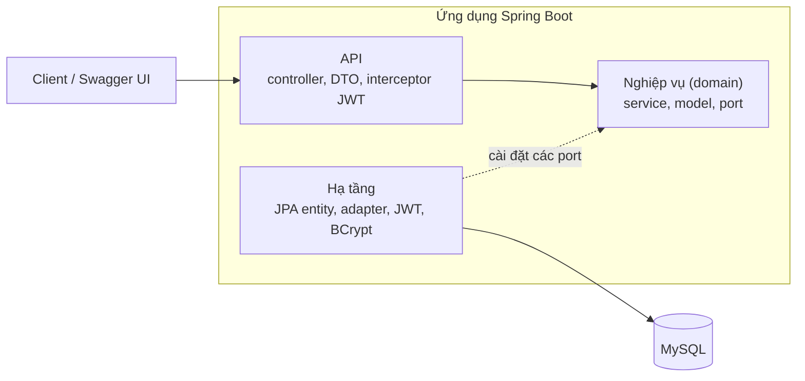
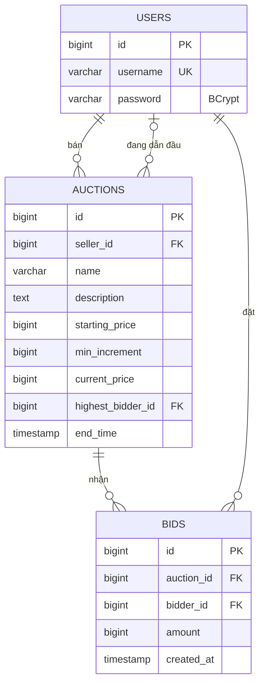

# Auction System: hệ thống đấu giá trực tuyến

Bài tập lớn môn Kiến trúc phần mềm, **Pha 1**. Nhóm 11.

Backend REST cho phép người dùng đăng ký, tạo phiên đấu giá, đặt giá và xem kết quả. Pha 1 chỉ làm chức năng cơ bản, chưa tối ưu. Các điểm nghẽn quan sát được đã được ghi lại ở mục 8 và 9 để cải tiến ở Pha 2.

## 1. Bài toán và phạm vi

Người dùng đã đăng nhập có thể là **người bán** (tạo phiên) hoặc **người mua** (đặt giá) tùy từng phiên, không có role cố định. Khách chưa đăng nhập chỉ xem được danh sách phiên, chi tiết phiên và lịch sử đặt giá.

Quy tắc nghiệp vụ chính:

- Giá đặt đầu tiên phải từ giá khởi điểm; các lượt sau phải từ `giá hiện tại + bước giá`.
- Chỉ đặt giá được khi phiên còn hạn; người bán không được đặt giá phiên của mình.
- Chỉ người bán mới xóa được phiên, và chỉ khi phiên chưa có lượt đặt giá nào.
- Trạng thái phiên (`ACTIVE`/`ENDED`) không lưu trong DB mà suy ra từ `end_time`.
- Người thắng là người dẫn đầu của phiên đã kết thúc.

Ngoài phạm vi Pha 1: thanh toán, upload ảnh, phân trang, xử lý đồng thời.

## 2. Công nghệ

| Thành phần | Lựa chọn |
|---|---|
| Ngôn ngữ, framework | Java 17, Spring Boot 3.3 |
| Cơ sở dữ liệu | MySQL 8, truy cập qua JPA/Hibernate |
| Xác thực | JWT (jjwt), mật khẩu băm BCrypt |
| Tài liệu API | OpenAPI/Swagger (springdoc) |
| Đóng gói | Docker, docker compose |
| Kiểm thử | JUnit 5, Mockito; Locust cho kiểm thử tải |

## 3. Kiến trúc

Hệ thống chia 3 tầng: **API → Nghiệp vụ → Truy cập dữ liệu**. Tầng nghiệp vụ là Java thuần, không import Spring hay JPA.



```
ktpm.uet.vnu.auction
├── api/              controller, dto, security (interceptor JWT), error (xử lý lỗi chung)
├── domain/           model, service, port (interface repository), exception
└── infrastructure/   persistence (entity, Jpa repository, adapter), security, config
```

Các quyết định thiết kế:

- **Port và adapter:** tầng nghiệp vụ chỉ biết các interface `AuctionRepository`, `BidRepository`... Bản cài đặt JPA nằm ở tầng hạ tầng và đổi giữa entity với model thuần. Test `DomainLayerPurityTest` tự động kiểm tra tầng domain không import framework.
- **Transaction:** nghiệp vụ gọi `TransactionRunner` thay vì `@Transactional`, nên không phụ thuộc Spring.
- **Xử lý lỗi:** mọi lỗi nghiệp vụ là `DomainException` kèm `ErrorCode`; `GlobalExceptionHandler` đổi thành JSON thống nhất, controller không có `try/catch`.

## 4. Đặc tả

### 4.1 Cơ sở dữ liệu



### 4.2 API

Đặc tả OpenAPI: [docs/openapi.yaml](docs/openapi.yaml)
· Xem trực quan: [Swagger Editor](https://editor.swagger.io/?url=https://raw.githubusercontent.com/Hisuuz06/auction-project/main/docs/openapi.yaml)

Khi ứng dụng đang chạy, cùng nội dung có ở Swagger UI (`/swagger-ui.html`) và `/v3/api-docs.yaml`.

| # | Method | Endpoint | Mô tả | Cần token |
|---|---|---|---|---|
| 1 | POST | `/api/auth/register` | Đăng ký | Không |
| 2 | POST | `/api/auth/login` | Đăng nhập, nhận JWT | Không |
| 3 | GET | `/api/auctions` | Danh sách phiên | Không |
| 4 | GET | `/api/auctions/{id}` | Chi tiết phiên | Không |
| 5 | POST | `/api/auctions` | Tạo phiên | Có |
| 6 | DELETE | `/api/auctions/{id}` | Xóa phiên | Có |
| 7 | GET | `/api/auctions/{id}/bids` | Lịch sử đặt giá | Không |
| 8 | POST | `/api/auctions/{id}/bids` | Đặt giá | Có |
| 9 | GET | `/api/users/me/won-auctions` | Các phiên đã thắng | Có |

Request và response chi tiết, mã lỗi: xem [docs/api.md](docs/api.md) hoặc Swagger UI. Lỗi trả về dạng `{timestamp, status, code, message, path}`, ví dụ `BID_TOO_LOW` (409), `SELLER_CANNOT_BID` (403), `AUCTION_ENDED` (409).

## 5. Bảo mật

- Đăng nhập trả JWT (hạn 1 giờ). Mật khẩu lưu dạng băm BCrypt.
- Một **interceptor** kiểm tra token một lần cho các endpoint cần xác thực, rồi gắn `userId` vào request; controller chỉ đọc `userId`, không tự xử lý token.
- Endpoint công khai: đăng ký, đăng nhập, xem danh sách, chi tiết phiên, lịch sử đặt giá và Swagger. Còn lại cần `Authorization: Bearer <token>`.
- Việc "có phải người bán không" là quy tắc nghiệp vụ, kiểm tra ở tầng nghiệp vụ bằng cách so `userId` với dữ liệu phiên.

## 6. Chạy dự án

Cần Docker. Từ thư mục gốc:

```bash
docker compose up -d --build
```

- Swagger UI: http://localhost:8080/swagger-ui.html
- Có thể nạp dữ liệu mẫu (3 tài khoản `seller1`, `buyer1`, `buyer2`, mật khẩu `Passw0rd!`, và các phiên mẫu): [ĐIỀN: cách bật, ví dụ `SPRING_PROFILES_ACTIVE=seed docker compose up -d --build`]. Đây chỉ là tài khoản thử.
- Dùng endpoint cần đăng nhập trên Swagger: gọi `POST /api/auth/login`, copy `token`, bấm **Authorize** và dán token (không gõ chữ `Bearer`).
- Dừng: `docker compose down` (thêm `-v` để xóa dữ liệu).

Chạy test: `mvn clean verify` (cần JDK 17).

## 7. Kiểm thử

- **Test tự động:** [ĐIỀN: số] test gồm luật đặt giá (`BidServiceTest`), phiên đấu giá, xác thực, test controller (`@WebMvcTest`) và test kiểm tra phân tầng.
- **Kịch bản chạy tay trên Swagger:** [ĐIỀN: số] kịch bản, tất cả đạt (đặt giá hợp lệ, giá quá thấp, người bán tự đặt giá, phiên đã kết thúc, không token, token sai...). [ĐIỀN: link tới bảng kịch bản nếu có]

## 8. Kiểm thử tải (Kaggle CPU)

Notebook: [loadtest/load-test.ipynb](loadtest/load-test.ipynb) (kèm [locustfile.py](loadtest/locustfile.py)). Chạy toàn bộ trên một notebook Kaggle để cấu hình phần cứng cố định; app và công cụ tải dùng chung CPU.

| Thông số | Giá trị |
|---|---|
| Phần cứng | [ĐIỀN: kết quả `nproc`, `free -h`] |
| JVM | [ĐIỀN: ví dụ JDK 17, `-Xms1g -Xmx2g`] |
| Dữ liệu | [ĐIỀN: ví dụ 1000 phiên] |
| Tải | [ĐIỀN: ví dụ 50 người dùng ảo, 2 phút, khởi động nóng 30 giây] |
| Số lần đo | [ĐIỀN: ví dụ 3 lần, lấy trung vị] |

Kết quả baseline:

| Endpoint | RPS | p50 (ms) | p95 (ms) | Lỗi |
|---|---|---|---|---|
| GET /api/auctions | [ĐIỀN] | [ĐIỀN] | [ĐIỀN] | [ĐIỀN] |
| GET /api/auctions/{id} | [ĐIỀN] | [ĐIỀN] | [ĐIỀN] | [ĐIỀN] |
| POST /api/auctions/{id}/bids | [ĐIỀN] | [ĐIỀN] | [ĐIỀN] | [ĐIỀN] |

Nhận xét: [ĐIỀN: 2-3 câu, ví dụ endpoint nào chậm nhất và vì sao, CPU có kịch trần không].

## 9. Hạn chế và hướng Pha 2

- **Xử lý đồng thời khi đặt giá:** chưa có khóa nên hai người đặt cùng lúc có thể cùng qua kiểm tra. [ĐIỀN: bằng chứng từ kiểm tra dữ liệu sau khi tải, nếu có]
- **`GET /api/auctions` trả toàn bộ danh sách** (chưa phân trang), chậm khi dữ liệu lớn.
- **Truy vấn theo người dùng** (`won-auctions`) chưa có index phù hợp.
- Hướng cải tiến: [ĐIỀN: ví dụ khóa lạc quan, phân trang, cache, index] và đánh giá trước/sau trên cùng cấu hình Kaggle.

## 10. Thành viên

| Họ tên | Phụ trách |
|---|---|
| [ĐIỀN] | Xác thực, JWT, Docker, kiểm thử tải |
| [ĐIỀN] | Phiên đấu giá, README (kiến trúc, ERD, API) |
| [ĐIỀN] | Đặt giá, Swagger, test, README (chạy, kiểm thử) |
