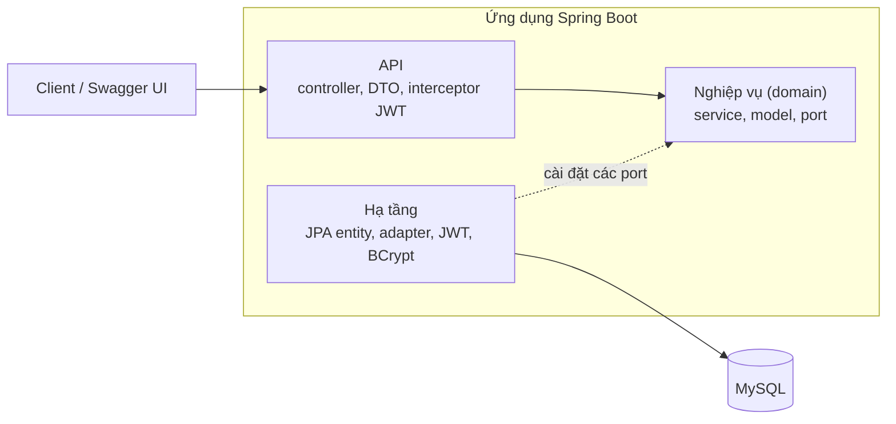
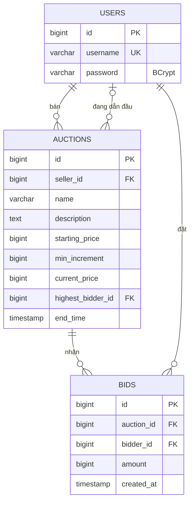

# Auction System: hệ thống đấu giá trực tuyến

Bài tập lớn môn Kiến trúc phần mềm, **Pha 1**. Nhóm 11.

Backend REST cho phép người dùng đăng ký, tạo phiên đấu giá, đặt giá và xem kết quả. Pha 1 chỉ làm chức năng cơ bản, chưa tối ưu. Các điểm nghẽn quan sát được đã được ghi lại ở mục 8 và 9 để cải tiến ở Pha 2.

## 1. Bài toán và phạm vi

Người dùng đã đăng nhập có thể là **người bán** (tạo phiên) hoặc **người mua** (đặt giá) tùy từng phiên, không có role cố định. Khách chưa đăng nhập chỉ xem được danh sách phiên, chi tiết phiên và lịch sử đặt giá.

Quy tắc nghiệp vụ chính:

- Giá đặt đầu tiên phải từ giá khởi điểm; các lượt sau phải từ `giá hiện tại + bước giá`.
- Chỉ đặt giá được khi phiên còn hạn; người bán không được đặt giá phiên của mình.
- Chỉ người bán mới xóa được phiên, và chỉ khi phiên chưa có lượt đặt giá nào.
- Trạng thái phiên (`ACTIVE`/`ENDED`) không lưu trong DB mà suy ra từ `end_time`.
- Người thắng là người dẫn đầu của phiên đã kết thúc.

Ngoài phạm vi Pha 1: thanh toán, upload ảnh, phân trang, xử lý đồng thời.

## 2. Công nghệ

| Thành phần | Lựa chọn |
|---|---|
| Ngôn ngữ, framework | Java 17, Spring Boot 3.3 |
| Cơ sở dữ liệu | MySQL 8, truy cập qua JPA/Hibernate |
| Xác thực | JWT (jjwt), mật khẩu băm BCrypt |
| Tài liệu API | OpenAPI/Swagger (springdoc) |
| Đóng gói | Docker, docker compose |
| Kiểm thử | JUnit 5, Mockito; Locust cho kiểm thử tải |

## 3. Kiến trúc

Hệ thống chia 3 tầng: **API → Nghiệp vụ → Truy cập dữ liệu**. Tầng nghiệp vụ là Java thuần, không import Spring hay JPA.



```
ktpm.uet.vnu.auction
├── api/              controller, dto, security (interceptor JWT), error (xử lý lỗi chung)
├── domain/           model, service, port (interface repository), exception
└── infrastructure/   persistence (entity, Jpa repository, adapter), security, config
```

Các quyết định thiết kế:

- **Port và adapter:** tầng nghiệp vụ chỉ biết các interface `AuctionRepository`, `BidRepository`... Bản cài đặt JPA nằm ở tầng hạ tầng và đổi giữa entity với model thuần. Test `DomainLayerPurityTest` tự động kiểm tra tầng domain không import framework.
- **Transaction:** nghiệp vụ gọi `TransactionRunner` thay vì `@Transactional`, nên không phụ thuộc Spring.
- **Xử lý lỗi:** mọi lỗi nghiệp vụ là `DomainException` kèm `ErrorCode`; `GlobalExceptionHandler` đổi thành JSON thống nhất, controller không có `try/catch`.

## 4. Đặc tả

### 4.1 Cơ sở dữ liệu



### 4.2 API

Đặc tả OpenAPI: [docs/openapi.yaml](docs/openapi.yaml)
· Xem trực quan: [Swagger Editor](https://editor.swagger.io/?url=https://raw.githubusercontent.com/Hisuuz06/auction-project/main/docs/openapi.yaml)

Khi ứng dụng đang chạy, cùng nội dung có ở Swagger UI (`/swagger-ui.html`) và `/v3/api-docs.yaml`.

| # | Method | Endpoint | Mô tả | Cần token |
|---|---|---|---|---|
| 1 | POST | `/api/auth/register` | Đăng ký | Không |
| 2 | POST | `/api/auth/login` | Đăng nhập, nhận JWT | Không |
| 3 | GET | `/api/auctions` | Danh sách phiên | Không |
| 4 | GET | `/api/auctions/{id}` | Chi tiết phiên | Không |
| 5 | POST | `/api/auctions` | Tạo phiên | Có |
| 6 | DELETE | `/api/auctions/{id}` | Xóa phiên | Có |
| 7 | GET | `/api/auctions/{id}/bids` | Lịch sử đặt giá | Không |
| 8 | POST | `/api/auctions/{id}/bids` | Đặt giá | Có |
| 9 | GET | `/api/users/me/won-auctions` | Các phiên đã thắng | Có |

Request và response chi tiết, mã lỗi: xem [docs/api.md](docs/api.md) hoặc Swagger UI. Lỗi trả về dạng `{timestamp, status, code, message, path}`, ví dụ `BID_TOO_LOW` (409), `SELLER_CANNOT_BID` (403), `AUCTION_ENDED` (409).

## 5. Bảo mật

- Đăng nhập trả JWT (hạn 1 giờ). Mật khẩu lưu dạng băm BCrypt.
- Một **interceptor** kiểm tra token một lần cho các endpoint cần xác thực, rồi gắn `userId` vào request; controller chỉ đọc `userId`, không tự xử lý token.
- Endpoint công khai: đăng ký, đăng nhập, xem danh sách, chi tiết phiên, lịch sử đặt giá và Swagger. Còn lại cần `Authorization: Bearer <token>`.
- Việc "có phải người bán không" là quy tắc nghiệp vụ, kiểm tra ở tầng nghiệp vụ bằng cách so `userId` với dữ liệu phiên.

## 6. Chạy dự án

Cần Docker. Từ thư mục gốc:

```bash
docker compose up -d --build
```

- Swagger UI: http://localhost:8080/swagger-ui.html
- Khi mới chạy, cơ sở dữ liệu **trống**. Thử nhanh trên Swagger:
    1. `POST /api/auth/register` tạo hai tài khoản, ví dụ `seller1` và `buyer1` (mật khẩu từ 8 ký tự).
    2. `POST /api/auth/login` với `seller1`, copy `token`, bấm **Authorize** và dán token (không gõ chữ `Bearer`).
    3. `POST /api/auctions` để tạo một phiên.
    4. Đăng nhập `buyer1`, bấm **Authorize** lại (Logout rồi dán token mới), rồi `POST /api/auctions/{id}/bids` để đặt giá.
- Dừng: `docker compose down` (thêm `-v` để xóa dữ liệu).

Chạy test: `mvn clean verify` (cần JDK 17).

## 7. Kiểm thử

- **Test tự động:** Gồm luật đặt giá (`BidServiceTest`), phiên đấu giá, xác thực, test controller (`@WebMvcTest`) và test kiểm tra phân tầng.
- **Kịch bản chạy tay trên Swagger:** Tất cả đạt (đặt giá hợp lệ, giá quá thấp, người bán tự đặt giá, phiên đã kết thúc, không token, token sai...).

## 8. Kiểm thử tải (Kaggle CPU)

Notebook:https://www.kaggle.com/code/hieukid/ki-m-t-i-u-gi. Chạy toàn bộ trên một notebook Kaggle để cấu hình phần cứng cố định; app và công cụ tải dùng chung CPU.

### 8.1. Môi trường kiểm thử

Nhóm sử dụng Locust để kiểm thử tải các REST API trên môi trường Kaggle CPU.

| Thông số | Giá trị |
|---|---|
| Phần cứng | Intel Xeon 2.20 GHz, 4 CPU logic, RAM 31 GiB |
| Công nghệ | Java 17, Spring Boot 3.3.5, MySQL 8 |
| Công cụ | Locust (Python) |
| Dữ liệu | 100 phiên đấu giá mẫu cho GET; dữ liệu thử nghiệm riêng cho POST |
| Mức tải | 10, 30, 50 người dùng ảo |
| Thời gian | Warm-up 15 giây, đo 60 giây/mức tải |

Spring Boot, MySQL và Locust chạy trên cùng môi trường Kaggle CPU.

### 8.2. Kết quả kiểm thử Baseline

Kết quả tại mức tải **50 người dùng ảo**:

| API | RPS | Avg (ms) | p95 (ms) | Error Rate |
|---|---:|---:|---:|---:|
| GET /api/auctions | 32,33 | 4,15 | 6 | 0% |
| GET /api/auctions/{id} | 98,64 | 3,81 | 5 | 0% |
| POST /api/auctions | 127,38 | 28,49 | 45 | 0% |
| POST /api/auctions/{id}/bids | 119,97 | 52,82 | 97 | 0% |

Tổng cộng ba bài kiểm thử tải thông thường thực hiện
**40.940 request**, không ghi nhận request thất bại theo Locust.

Nhóm thực hiện thêm kiểm thử nhiều người dùng đồng thời đặt cùng một mức giá
trên một phiên đấu giá. Theo quy tắc nghiệp vụ, tối đa một lượt đặt giá
ở mức giá đó được chấp nhận.

| Người dùng đồng thời | Số vòng kiểm thử | Số bid được chấp nhận mỗi vòng | Vòng vi phạm |
|---|---:|---:|---:|
| 10 | 5 | 2 | 5/5 |
| 30 | 5 | 2–3 | 5/5 |
| 50 | 5 | 2 | 5/5 |
| **Tổng** | **15** | | **15/15** |

**Kết quả:** Cả 15/15 vòng kiểm thử đều vi phạm bất biến nghiệp vụ.
Hệ thống chấp nhận nhiều lượt đặt giá cùng mức giá trên một phiên,
cho thấy dấu hiệu Race Condition khi xử lý các request đồng thời.

### 8.3. Nhận xét và đánh giá

- **Hiệu năng:** Thông lượng tăng khi số người dùng tăng từ 10 lên 50.
  Hệ thống đáp ứng ổn định trong phạm vi tải đã kiểm thử.
- **API GET:** Thời gian phản hồi thấp, trung bình dưới 5 ms.
  GET chi tiết có RPS cao hơn do được gọi nhiều hơn trong kịch bản.
- **API POST:** POST Bid có thời gian phản hồi cao nhất (52,82 ms),
  liên quan đến xử lý nghiệp vụ và cập nhật dữ liệu.
- **Độ ổn định:** Tỷ lệ request thất bại theo Locust là 0%
  trong các bài kiểm thử tải thông thường.
- **Race Condition:** Kiểm thử đặt giá đồng thời phát hiện 15/15 vòng
  vi phạm bất biến nghiệp vụ, có trường hợp 2–3 bid cùng giá
  được chấp nhận.
- **Hướng cải tiến:** Nghiên cứu Optimistic/Pessimistic Locking,
  kiểm thử lại và so sánh hiệu năng trước–sau.

**Kết luận:** Hệ thống đáp ứng ổn định các mức tải đã thử nghiệm
nhưng còn tồn tại vấn đề về tính nhất quán khi đặt giá đồng thời.

## 9. Hạn chế và hướng Pha 2

- **Xử lý đồng thời khi đặt giá:** chưa có khóa nên hai người đặt cùng lúc có thể cùng qua kiểm tra.
- **`GET /api/auctions` trả toàn bộ danh sách** (chưa phân trang), chậm khi dữ liệu lớn.
- **Truy vấn theo người dùng** (`won-auctions`) chưa có index phù hợp.
- Hướng cải tiến:

| Vấn đề | Thuộc tính | Cải tiến | Chỉ số đo trước và sau |
|---|---|---|---|
| Đặt giá đồng thời | Nhất quán dữ liệu | Khóa lạc quan (`@Version`) kèm thử lại | Số phiên lệch giá và bid trùng giá (mong đợi 0); thông lượng đặt giá |
| Danh sách không phân trang | Hiệu năng | Phân trang `page`, `size` | p95 và kích thước response của `GET /api/auctions` |
| Đọc nhiều, xuống DB mọi lần | Hiệu năng, mở rộng | Cache chi tiết phiên, xóa khi có bid mới | RPS và p95 của các `GET` |
| Thiếu chỉ mục kết hợp | Hiệu năng | Chỉ mục cho `won-auctions` và lịch sử bid | p95 của hai endpoint đó |

## 10. Thành viên

| Họ tên            | Phụ trách                                                    |
|-------------------|--------------------------------------------------------------|
| Nguyễn Ngọc Thắng | Xác thực, JWT, test                                          |
| Đào Trung Hiếu    | Phiên đấu giá, test, README (chạy, kiểm thử kaggle)          |
| Lê Trung Hiếu     | Đặt giá, Swagger, Docker, test, README (kiến trúc, ERD, API) |
