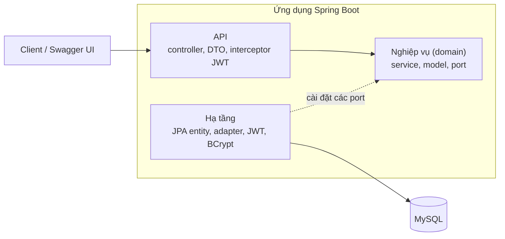
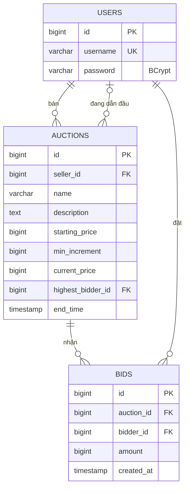

# Auction System: hệ thống đấu giá trực tuyến

Bài tập lớn môn Kiến trúc phần mềm, **Pha 1**. Nhóm 11.

## 1. Mô tả bài toán và quy tắc nghiệp vụ của hệ thống

### 1.1. Mô tả bài toán

Trong hoạt động mua bán trực tuyến, đấu giá là hình thức cho phép nhiều người mua cạnh tranh để sở hữu một sản phẩm thông qua việc đưa ra các mức giá khác nhau. Người bán thiết lập giá khởi điểm, bước giá tối thiểu và thời hạn đấu giá. Khi phiên kết thúc, người đưa ra mức giá hợp lệ cao nhất sẽ trở thành người thắng.

Nhóm xây dựng hệ thống Backend đấu giá trực tuyến (Online Auction Backend) cung cấp các REST API cho phép người dùng đăng ký, đăng nhập, tạo phiên đấu giá, tham gia đặt giá, theo dõi lịch sử và xem kết quả đấu giá.

Hệ thống không phân chia cố định vai trò người mua và người bán. Một người dùng có thể tạo phiên đấu giá của mình và tham gia đặt giá ở các phiên do người khác tạo.

### 1.2. Chức năng và quy tắc nghiệp vụ

#### 1.2.1 Các chức năng chính:

+ Quản lý tài khoản: Đăng ký, đăng nhập và xác thực người dùng.

+ Quản lý phiên đấu giá: Tạo, xem danh sách, xem chi tiết và xóa phiên khi đủ điều kiện.

+ Đặt giá: Người dùng đã đăng nhập có thể tham gia đặt giá trong các phiên của người khác.

+ Lịch sử đấu giá: Xem danh sách các lượt đặt giá của từng phiên.

+ Kết quả đấu giá: Xác định người thắng khi phiên kết thúc.

#### 1.2.2 Các quy tắc nghiệp vụ:

+ Khách chưa đăng nhập chỉ được xem danh sách, chi tiết và lịch sử đặt giá.

+ Giá đặt đầu tiên phải lớn hơn hoặc bằng giá khởi điểm. Các lượt tiếp theo phải lớn hơn hoặc bằng giá hiện tại + bước giá tối thiểu.

+ Chỉ được đặt giá khi phiên còn thời hạn và người bán không được đặt giá trong phiên của mình.

+ Chỉ chủ phiên mới được xóa phiên và chỉ khi chưa có lượt đặt giá nào.

+ Trạng thái ACTIVE hoặc ENDED được xác định dựa trên endTime, không lưu trực tiếp trong cơ sở dữ liệu.

+ Người thắng là người dẫn đầu khi phiên kết thúc. Nếu không có lượt đặt giá nào thì phiên không có người thắng.

## 2. Công nghệ

| Thành phần | Lựa chọn |
|---|---|
| Ngôn ngữ, framework | Java 17, Spring Boot 3.3 |
| Cơ sở dữ liệu | MySQL 8, truy cập qua JPA/Hibernate |
| Xác thực | JWT (jjwt), mật khẩu băm BCrypt |
| Tài liệu API | OpenAPI/Swagger (springdoc) |
| Đóng gói | Docker, docker compose |
| Kiểm thử | JUnit 5, Mockito; Locust(kiểm thử tải trên Kaggle CPU) |

## 3. Kiến trúc

Hệ thống chia 3 tầng: **API → Nghiệp vụ → Truy cập dữ liệu**. Tầng nghiệp vụ là Java thuần, không import Spring hay JPA.



```
ktpm.uet.vnu.auction
├── api/              controller, dto, security (interceptor JWT), error (xử lý lỗi chung)
├── domain/           model, service, port (interface repository), exception
└── infrastructure/   persistence (entity, Jpa repository, adapter), security, config
```

Các quyết định thiết kế:

- **Port và adapter:** tầng nghiệp vụ chỉ biết các interface `AuctionRepository`, `BidRepository`... Bản cài đặt JPA nằm ở tầng hạ tầng và đổi giữa entity với model thuần. Test `DomainLayerPurityTest` tự động kiểm tra tầng domain không import framework.
- **Transaction:** nghiệp vụ gọi `TransactionRunner` thay vì `@Transactional`, nên không phụ thuộc Spring.
- **Xử lý lỗi:** mọi lỗi nghiệp vụ là `DomainException` kèm `ErrorCode`; `GlobalExceptionHandler` đổi thành JSON thống nhất, controller không có `try/catch`.

## 4. Đặc tả

### 4.1 Cơ sở dữ liệu



### 4.2 API

Đặc tả OpenAPI: [docs/openapi.yaml](docs/openapi.yaml)
· Xem trực quan: [Swagger Editor](https://editor.swagger.io/?url=https://raw.githubusercontent.com/Hisuuz06/auction-project/main/docs/openapi.yaml)

Khi ứng dụng đang chạy, cùng nội dung có ở Swagger UI (`/swagger-ui.html`) và `/v3/api-docs.yaml`.

| # | Method | Endpoint | Mô tả | Cần token |
|---|---|---|---|---|
| 1 | POST | `/api/auth/register` | Đăng ký | Không |
| 2 | POST | `/api/auth/login` | Đăng nhập, nhận JWT | Không |
| 3 | GET | `/api/auctions` | Danh sách phiên | Không |
| 4 | GET | `/api/auctions/{id}` | Chi tiết phiên | Không |
| 5 | POST | `/api/auctions` | Tạo phiên | Có |
| 6 | DELETE | `/api/auctions/{id}` | Xóa phiên | Có |
| 7 | GET | `/api/auctions/{id}/bids` | Lịch sử đặt giá | Không |
| 8 | POST | `/api/auctions/{id}/bids` | Đặt giá | Có |
| 9 | GET | `/api/users/me/won-auctions` | Các phiên đã thắng | Có |

Request và response chi tiết, mã lỗi: xem [docs/api.md](docs/api.md) hoặc Swagger UI. Lỗi trả về dạng `{timestamp, status, code, message, path}`, ví dụ `BID_TOO_LOW` (409), `SELLER_CANNOT_BID` (403), `AUCTION_ENDED` (409).

## 5. Bảo mật

- Đăng nhập trả JWT (hạn 1 giờ). Mật khẩu lưu dạng băm BCrypt.
- Một **interceptor** kiểm tra token một lần cho các endpoint cần xác thực, rồi gắn `userId` vào request; controller chỉ đọc `userId`, không tự xử lý token.
- Endpoint công khai: đăng ký, đăng nhập, xem danh sách, chi tiết phiên, lịch sử đặt giá và Swagger. Còn lại cần `Authorization: Bearer <token>`.
- Việc "có phải người bán không" là quy tắc nghiệp vụ, kiểm tra ở tầng nghiệp vụ bằng cách so `userId` với dữ liệu phiên.

## 6. Chạy dự án

Cần Docker. Từ thư mục gốc:

```bash
docker compose up -d --build
```

- Swagger UI: http://localhost:8080/swagger-ui.html
- Khi mới chạy, cơ sở dữ liệu **trống**. Thử nhanh trên Swagger:
    1. `POST /api/auth/register` tạo hai tài khoản, ví dụ `seller1` và `buyer1` (mật khẩu từ 8 ký tự).
    2. `POST /api/auth/login` với `seller1`, copy `token`, bấm **Authorize** và dán token (không gõ chữ `Bearer`).
    3. `POST /api/auctions` để tạo một phiên.
    4. Đăng nhập `buyer1`, bấm **Authorize** lại (Logout rồi dán token mới), rồi `POST /api/auctions/{id}/bids` để đặt giá.
- Dừng: `docker compose down` (thêm `-v` để xóa dữ liệu).

Chạy test: `mvn clean verify` (cần JDK 17).

## 7. Kiểm thử

- **Test tự động:** Gồm luật đặt giá (`BidServiceTest`), phiên đấu giá, xác thực, test controller (`@WebMvcTest`) và test kiểm tra phân tầng.
- **Kịch bản chạy tay trên Swagger:** Tất cả đạt (đặt giá hợp lệ, giá quá thấp, người bán tự đặt giá, phiên đã kết thúc, không token, token sai...).

## 8. Kiểm thử tải (Kaggle CPU)

Notebook:https://www.kaggle.com/code/hieukid/ki-m-t-i-u-gi. 
Chạy toàn bộ trên một notebook Kaggle để cấu hình phần cứng cố định; app và công cụ tải dùng chung CPU.
Tài liệu chi tiết kết quả kiểm thử kaggle : https://docs.google.com/document/d/1TcPU92MZsRa75RKD6NCUSbC3Xl_WioaLVe7TkliPzOo/edit?usp=sharing

## 9. Hạn chế và hướng cải tiến ở pha 2
### 9.1 Hạn chế
- **Xử lý đồng thời khi đặt giá:** chưa có khóa nên hai người đặt cùng lúc có thể cùng qua kiểm tra.
- **`GET /api/auctions` trả toàn bộ danh sách** (chưa phân trang), chậm khi dữ liệu lớn.
- **Truy vấn theo người dùng** (`won-auctions`) chưa có index phù hợp.
### 9.2 Hướng cải tiến

| Vấn đề | Thuộc tính | Cải tiến | Chỉ số đo trước và sau |
|---|---|---|---|
| Race Condition khi nhiều người đặt giá đồng thời: Các request có thể cùng đọc một mức giá hiện tại và cùng vượt qua bước kiểm tra hợp lệ, dẫn đến nhiều lượt đặt giá trùng mức được chấp nhận trên một phiên | Tính nhất quán và toàn vẹn dữ liệu | Áp dụng Optimistic Locking bằng @Version trong JPA Entity để phát hiện xung đột khi cập nhật phiên đấu giá. Khi xảy ra xung đột, thực hiện retry có giới hạn và kiểm tra lại giá đặt trên dữ liệu mới nhất. Đồng thời nghiên cứu Pessimistic Locking để khóa bản ghi trong transaction, sau đó so sánh hai phương án. | Số phiên lệch giá và bid trùng giá (mong đợi 0); thông lượng đặt giá |
| API danh sách chưa hỗ trợ phân trang: GET /api/auctions trả về toàn bộ phiên đấu giá. Khi số lượng phiên tăng lớn, hệ thống phải truy vấn, xử lý và truyền nhiều dữ liệu trong một request, có nguy cơ làm tăng thời gian phản hồi và sử dụng tài nguyên. | Hiệu năng | Sử dụng Spring Data JPA Pageable để bổ sung phân trang với tham số page, size và sắp xếp ổn định. Giới hạn số bản ghi tối đa mỗi trang, đồng thời trả về thông tin phân trang để client có thể truy xuất từng phần dữ liệu. | p95 của GET /api/auctions, kích thước JSON response, thời gian truy vấn và RPS khi số phiên tăng từ 100 lên 1.000–10.000.
| Các request đọc lặp lại vẫn truy vấn database: Khi nhiều người cùng xem một phiên đấu giá, mỗi lần gọi API chi tiết đều truy cập MySQL, kể cả khi dữ liệu chưa thay đổi. Điều này có thể gây tải truy vấn không cần thiết. | Hiệu năng, mở rộng | Sử dụng Spring Cache kết hợp Caffeine để lưu tạm dữ liệu chi tiết phiên đấu giá. Các request đọc có thể sử dụng dữ liệu cache. Khi có bid mới hoặc xóa phiên, thực hiện cập nhật hoặc vô hiệu hóa cache sau khi transaction thành công; | RPS và p95 của API GET chi tiết phiên, tỷ lệ Cache Hit/Miss, số truy vấn MySQL và độ chính xác của dữ liệu sau khi đặt giá. |
| truy vấn chưa được tối ưu bằng chỉ mục phù hợp: Các chức năng xem phiên đã thắng (won-auctions) và lịch sử đặt giá cần lọc, sắp xếp dữ liệu theo nhiều trường. Khi số bản ghi tăng, việc thiếu chỉ mục phù hợp có thể làm MySQL phải quét nhiều dòng và tăng độ trễ truy vấn. | Hiệu năng | Sử dụng EXPLAIN ANALYZE để đánh giá kế hoạch thực thi truy vấn. Nghiên cứu tạo chỉ mục kết hợp, chẳng hạn (highest_bidder_id, end_time) cho danh sách phiên đã thắng và (auction_id, created_at) cho lịch sử đặt giá. Kiểm thử trước–sau để lựa chọn index thực sự hiệu quả. | Thời gian thực thi SQL, số dòng được quét, kế hoạch truy vấn và p95 của hai API tương ứng. |
|Chưa hỗ trợ cập nhật giá đấu giá theo thời gian thực: Backend hiện chủ yếu cung cấp REST API, chưa có cơ chế chủ động gửi giá mới đến những người đang theo dõi phiên. Client muốn biết giá mới phải gọi lại API hoặc sử dụng polling định kỳ, có thể gây chậm cập nhật và tạo nhiều request GET. | Hiệu năng, khả năng mở rộng, khả năng sử dụng | Tích hợp WebSocket (Spring WebSocket/STOMP) để thiết lập kênh cập nhật theo từng phiên đấu giá. Sau khi một bid được lưu thành công và transaction commit, backend phát sự kiện chứa giá mới và người đang dẫn đầu tới các client đang theo dõi. Bổ sung cơ chế kết nối lại và đồng bộ dữ liệu qua REST API khi client bỏ lỡ thông báo. | Độ trễ từ lúc bid thành công đến khi client nhận giá mới (p95), số kết nối đồng thời, tỷ lệ nhận thông báo thành công và số request GET giảm được so với polling.

## 10. Thành viên

| Họ tên            | Phụ trách                                                    |
|-------------------|--------------------------------------------------------------|
| Nguyễn Ngọc Thắng | Xác thực, JWT, test                                          |
| Đào Trung Hiếu    | Phiên đấu giá, test, kiểm thử tải kaggle, README (chạy, kiểm thử)          |
| Lê Trung Hiếu     | Đặt giá, Swagger, Docker, test, README (kiến trúc, ERD, API) |
