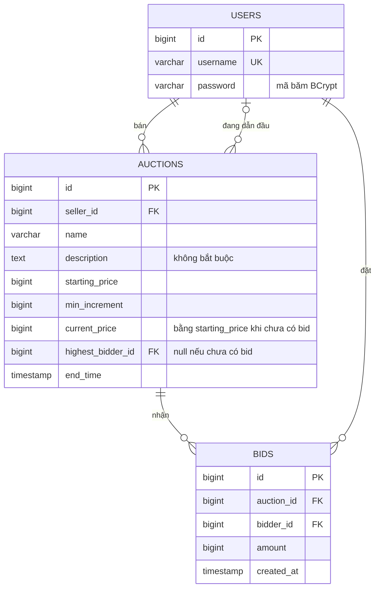

# Hệ thống đấu giá trực tuyến: ERD & API Spec (Pha 1)

## 1. Quy ước chung

| Mục | Quy ước |
|---|---|
| Base path | `/api` |
| Định dạng | JSON, UTF-8 |
| Xác thực | Header `Authorization: Bearer <JWT>`. Cột **Auth = Có** nghĩa là bắt buộc có token hợp lệ, kiểm tra ở filter, không viết lặp trong endpoint |
| Tiền | Số nguyên VND (`long`), ví dụ `500000` |
| Thời gian | ISO-8601 UTC, ví dụ `2026-11-01T10:00:00Z` |
| Phản hồi danh sách | Mảng JSON thuần, chưa phân trang (pha 1 chỉ làm chức năng cơ bản) |

**Định dạng lỗi (mọi endpoint):**

```json
{
  "timestamp": "2026-10-20T08:30:00Z",
  "status": 409,
  "code": "BID_TOO_LOW",
  "message": "Giá đặt phải từ 750000 trở lên",
  "path": "/api/auctions/7/bids"
}
```

---

## 2. ERD



**Ghi chú thiết kế**

- Hệ thống không có role cố định trong DB. "Người bán" và "người mua" được xác định theo từng phiên: người bán là `auctions.seller_id`, người mua là bất kỳ người dùng đã đăng nhập khác người bán.
- Không lưu cột `status`: trạng thái được suy ra khi đọc, `ENDED` nếu `now > end_time`, ngược lại `ACTIVE`. Nhờ vậy pha 1 không cần job tự đóng phiên.
- Người thắng của phiên đã kết thúc chính là `highest_bidder_id`, nên không cần cột `winner_id`.
- `current_price` và `highest_bidder_id` là dữ liệu lặp lại từ bảng `bids` để đọc nhanh. Đây cũng là chỗ có thể sai khi nhiều bid đồng thời (phân tích ở pha 2).
- Phiên được sắp xếp mới nhất trước theo `id` giảm dần (`id` tự tăng), nên không cần cột `created_at`.

---

## 3. Quy tắc nghiệp vụ

| Mã | Quy tắc |
|---|---|
| BR-1 | `username` không được trùng |
| BR-2 | `endTime` phải ở tương lai khi tạo phiên |
| BR-3 | Bid đầu tiên phải `>= starting_price`. Các bid sau phải `>= current_price + min_increment` |
| BR-4 | Chỉ đặt giá được khi phiên còn `ACTIVE` |
| BR-5 | Người bán không được đặt giá phiên của chính mình |
| BR-6 | Chỉ người bán mới xóa được phiên, và chỉ khi phiên chưa có bid nào |
| BR-7 | Bid hợp lệ cập nhật `current_price` và `highest_bidder_id` của phiên |
| BR-8 | Phiên "thắng" của một người dùng là phiên đã `ENDED` và có `highest_bidder_id` là người đó |

---

## 4. Danh sách endpoint

| # | Method | Endpoint | Mô tả | Auth |
|---|---|---|---|---|
| 1 | POST | `/api/auth/register` | Đăng ký | Không |
| 2 | POST | `/api/auth/login` | Đăng nhập, nhận JWT | Không |
| 3 | GET | `/api/auctions` | Danh sách tất cả phiên | Không |
| 4 | GET | `/api/auctions/{id}` | Chi tiết phiên | Không |
| 5 | POST | `/api/auctions` | Tạo phiên đấu giá | Có |
| 6 | DELETE | `/api/auctions/{id}` | Xóa phiên | Có |
| 7 | GET | `/api/auctions/{id}/bids` | Lịch sử bid của phiên | Không |
| 8 | POST | `/api/auctions/{id}/bids` | Đặt giá | Có |
| 9 | GET | `/api/users/me/won-auctions` | Các phiên tôi đã thắng | Có |

Các endpoint cần xác thực: 1 GET (#9), 2 POST (#5, #8) và 1 DELETE (#6). Như vậy đạt yêu cầu tối thiểu của đề (1 GET và 1 POST có xác thực).

**Cấu hình filter JWT:**

| Nhóm | Endpoint |
|---|---|
| Công khai (bỏ qua filter) | `POST /api/auth/**`, `GET /api/auctions`, `GET /api/auctions/{id}`, `GET /api/auctions/{id}/bids`, Swagger UI |
| Yêu cầu token | Tất cả endpoint còn lại |

---

## 5. Chi tiết endpoint

### 5.1 Auth

#### 1. `POST /api/auth/register`

Request:

```json
{ "username": "an.nguyen", "password": "Passw0rd!" }
```

Ràng buộc: `username` 3-30 ký tự, `password` tối thiểu 8 ký tự.

Response `201 Created`:

```json
{ "id": 1, "username": "an.nguyen" }
```

Lỗi: `400 VALIDATION_ERROR`, `409 USER_ALREADY_EXISTS`.

#### 2. `POST /api/auth/login`

Request:

```json
{ "username": "an.nguyen", "password": "Passw0rd!" }
```

Response `200 OK`:

```json
{ "token": "eyJhbGciOiJIUzI1NiJ9...", "tokenType": "Bearer", "expiresIn": 3600 }
```

Lỗi: `400 VALIDATION_ERROR`, `401 INVALID_CREDENTIALS`.

### 5.2 Auction

Đối tượng `Auction`:

```json
{
  "id": 7,
  "sellerId": 1,
  "name": "Đồng hồ cơ cổ 1970",
  "description": "Còn chạy tốt, kèm hộp gốc",
  "startingPrice": 500000,
  "minIncrement": 50000,
  "currentPrice": 700000,
  "minNextBid": 750000,
  "highestBidderId": 5,
  "endTime": "2026-11-01T10:00:00Z",
  "status": "ACTIVE"
}
```

- `status` là `ACTIVE` hoặc `ENDED`, suy ra từ `endTime`, không lưu trong DB.
- `minNextBid` là giá tối thiểu cho lượt đặt tiếp theo: bằng `startingPrice` nếu chưa có bid, ngược lại bằng `currentPrice + minIncrement`.
- Khi chưa có bid: `currentPrice = startingPrice`, `highestBidderId = null`.

#### 3. `GET /api/auctions`

Response `200 OK`: mảng các `Auction`, sắp xếp mới nhất trước (`id` giảm dần). Chưa có bộ lọc và chưa phân trang.

#### 4. `GET /api/auctions/{id}`

Response `200 OK`: đối tượng `Auction`.

Lỗi: `404 AUCTION_NOT_FOUND`.

#### 5. `POST /api/auctions` (cần token)

Request:

```json
{
  "name": "Đồng hồ cơ cổ 1970",
  "description": "Còn chạy tốt, kèm hộp gốc",
  "startingPrice": 500000,
  "minIncrement": 50000,
  "endTime": "2026-11-01T10:00:00Z"
}
```

Ràng buộc: `name` bắt buộc, tối đa 200 ký tự; `startingPrice > 0`; `minIncrement > 0`; `endTime` ở tương lai (BR-2). `description` không bắt buộc. `sellerId` lấy từ token.

Response `201 Created`: đối tượng `Auction`.

Lỗi: `400 VALIDATION_ERROR`, `401 UNAUTHORIZED`.

#### 6. `DELETE /api/auctions/{id}` (cần token)

Response `204 No Content`.

Lỗi: `401 UNAUTHORIZED`, `403 FORBIDDEN` (không phải người bán), `404 AUCTION_NOT_FOUND`, `409 AUCTION_HAS_BIDS` (BR-6).

#### 9. `GET /api/users/me/won-auctions` (cần token)

Trả về các phiên đã kết thúc mà người dùng hiện tại (lấy từ token) là người dẫn đầu (BR-8).

Response `200 OK`: mảng các `Auction`, sắp xếp theo `endTime` giảm dần. Mảng rỗng `[]` nếu chưa thắng phiên nào.

Lỗi: `401 UNAUTHORIZED`.

### 5.3 Bid

Đối tượng `Bid`:

```json
{ "id": 21, "auctionId": 7, "bidderId": 5, "amount": 700000, "createdAt": "2026-10-21T09:15:00Z" }
```

#### 7. `GET /api/auctions/{id}/bids`

Response `200 OK`: mảng các `Bid` của phiên, sắp xếp theo `amount` giảm dần. Mảng rỗng `[]` nếu chưa có bid.

Lỗi: `404 AUCTION_NOT_FOUND`.

#### 8. `POST /api/auctions/{id}/bids` (cần token)

Request:

```json
{ "amount": 750000 }
```

Response `201 Created`: đối tượng `Bid`. Phiên được cập nhật `currentPrice = amount` và `highestBidderId = bidderId` (BR-7).

Lỗi: `400 VALIDATION_ERROR`, `401 UNAUTHORIZED`, `403 SELLER_CANNOT_BID` (BR-5), `404 AUCTION_NOT_FOUND`, `409 AUCTION_ENDED` (BR-4), `409 BID_TOO_LOW` (BR-3).

---

## 6. Bảng mã lỗi

| HTTP | `code` | Khi nào |
|---|---|---|
| 400 | `VALIDATION_ERROR` | Dữ liệu vào sai định dạng hoặc vi phạm ràng buộc |
| 401 | `UNAUTHORIZED` | Thiếu, sai hoặc hết hạn token |
| 401 | `INVALID_CREDENTIALS` | Sai tên đăng nhập hoặc mật khẩu |
| 403 | `FORBIDDEN` | Không phải người bán của phiên |
| 403 | `SELLER_CANNOT_BID` | Người bán đặt giá phiên của chính mình |
| 404 | `AUCTION_NOT_FOUND` | Không có phiên đấu giá |
| 409 | `USER_ALREADY_EXISTS` | Trùng `username` |
| 409 | `AUCTION_HAS_BIDS` | Xóa phiên đã có bid |
| 409 | `AUCTION_ENDED` | Đặt giá khi phiên đã kết thúc |
| 409 | `BID_TOO_LOW` | Giá đặt thấp hơn `minNextBid` |
